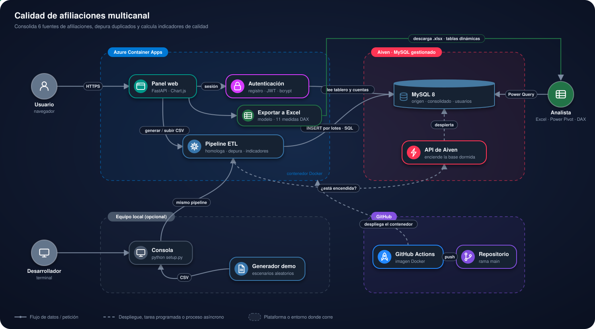

# Calidad de afiliaciones multicanal

<p>
  <a href="https://calidad-afiliaciones.blueocean-86680030.eastus.azurecontainerapps.io/"></a>
  <a href="https://frontend-nine-topaz-99.vercel.app"></a>
  <a href="https://d4i3vsgw7xwmh.cloudfront.net"></a>
</p>


## Contenido

1. [Presentación](#1-presentación)
2. [Estructura del proyecto](#2-estructura-del-proyecto)
3. [Arquitectura](#3-arquitectura)
4. [Plataformas y su función](#4-plataformas-y-su-función)
5. [Cómo usar la plataforma](#5-cómo-usar-la-plataforma)
6. [Instalación para pruebas](#6-instalación-para-pruebas)
7. [Autor y licencia](#7-autor-y-licencia)

---

## 1. Presentación

Consolidación y análisis de calidad de la producción de afiliaciones de una EPS
que recibe trámites por tres canales distintos, más un histórico de radicación
y un archivo de novedades laborales.

El problema: cada canal reporta con su propio formato, el mismo afiliado puede
radicar por varias vías, y no existe una cifra única de producción en la que se
pueda confiar.

### En pocas palabras

- **Qué hace:** junta los archivos de los tres canales de afiliación (digital, SAT y
  físico) y los históricos, identifica a cada afiliado con una sola llave, elimina
  los duplicados y entrega **una cifra única y confiable** de producción, con
  marcas de calidad para cada registro.
- **Para quién:** equipos de calidad u operación de una EPS que necesitan saber
  cuántas afiliaciones reales hubo y qué problemas tienen los datos.
- **Cómo se usa:** desde el navegador (panel web, sin instalar nada), desde la
  terminal (`python setup.py`) o desde Excel con Power Query.

### Demo en vivo

**Panel:** [abrir la demo en vivo](https://calidad-afiliaciones.blueocean-86680030.eastus.azurecontainerapps.io/)

El registro es público y libre — ver [Panel web](#51-panel-web) para el
detalle de cómo funciona por cuenta.

### El problema en concreto

Seis fuentes que no hablan entre sí:

| Fuente | Registros | Qué aporta |
|---|---|---|
| Canal digital | 64.562 | Portal y aplicación, con estado del trámite |
| SAT | 10.013 | Radicación oficial ante el Ministerio |
| Canal físico | 1.332 | Puntos de atención presencial |
| Radicación histórica | 218.416 | Antecedente del afiliado y entidad previa |
| Novedades laborales | 167.274 | Relaciones laborales, no afiliaciones |
| Catálogo de documentos | 15 | Homologación de tipos de identificación |

Tres obstáculos que impiden sumar directamente:

**Los tipos de documento no coinciden.** SAT usa el código numérico del
catálogo; las demás fuentes, la abreviatura. Un `CC` y un `3` son el mismo tipo
de documento, pero ningún sistema lo sabe.

**El mismo afiliado aparece varias veces.** Entre canales y dentro del mismo
canal. Sumar las tres fuentes cuenta a la misma persona hasta tres veces.

**Las novedades laborales parecen afiliaciones.** Son 167.274 registros que, si
se incluyen, multiplican la producción por más de tres.

### Cómo funciona

1. **Carga en MySQL.** Los archivos entran tal cual, como texto: rechazar filas
   impediría medir la calidad.
2. **Homologación.** Cada afiliado recibe una llave única (tipo + número de
   documento) común a todos los canales.
3. **Antecedente histórico.** Con la radicación histórica se decide si es
   reinscripción, traslado o afiliación nueva.
4. **Depuración.** Queda un registro por afiliado, según la prioridad del canal.
5. **Marcas de calidad.** Se acumulan sobre cada registro, sin reemplazar la
   clasificación.
6. **Indicadores.** Tablero en pantalla, panel web y exportación.

Las decisiones que sostienen cada paso están en **[docs/decisiones.md](docs/decisiones.md)**,
incluidos los criterios alternativos razonables y qué cambiaría al adoptarlos.

---

## 2. Estructura del proyecto

```
sql/
├── 01_esquema.sql          Tablas de origen con índices (una columna usuario_id
│                            por tabla, salvo el catálogo compartido)
├── 02_homologacion.sql     Llave única, antecedente y duplicidad
├── 03_consolidado.sql      Clasificación y marcas de calidad
├── 03b_materializar.sql    Estructura de la tabla `consolidado`
├── 04_indicadores.sql      Consultas de referencia para el tablero
└── 05_usuarios.sql         Cuentas del panel web (registro público)

proceso/
├── conexion.py             Conexión con la base
├── fuentes.py              Separador y codificación de cada archivo
├── carga.py                Carga por lotes
├── esquema.py              Ejecución de los .sql
├── analisis.py             Indicadores y exportación
└── pipeline.py             Esquema + carga + consolidado en una función,
                             usado por el botón "Generar datos de ejemplo"
                             del panel web

web/
├── main.py                 Rutas del panel (FastAPI + Jinja2)
├── tablero_datos.py        Consultas del tablero, agregadas por canal
├── exportar_excel.py       Libro de Excel con modelo de datos y medidas DAX
├── plantillas_excel/       Plantilla de ese libro (3 filas inventadas)
├── templates/              Portada, tablero y demás páginas
└── static/                 Estilos, gráficos (Chart.js) e íconos

generador/datos_demo.py     Datos sintéticos; en el panel, un escenario distinto
                             por generación
scripts/construir_plantilla_excel.ps1
                            Arma la plantilla de Excel con Excel de escritorio

datos/entrada/              Archivos de origen (uso por consola) · excluidos
datos/salida/               Consolidado exportado (uso por consola) · excluido
datos/entrada_usuarios/     Datos de ejemplo por cuenta del panel web · excluido
datos/salida_usuarios/      Exportación por cuenta del panel web · excluido
docs/decisiones.md          Criterios adoptados y sus alternativas
excel/                      Ver Power Query y Power Pivot más abajo
setup.py                    Comando único
```

---

## 3. Arquitectura

<p align="center">
  
</p>

- El panel web (FastAPI + Jinja2) corre el mismo pipeline ETL que usa la consola;
  cada cuenta ve solo sus propios datos.
- Si la base MySQL 8 está dormida, el proyecto la despierta antes de conectarse.
- **En local**, `python setup.py` ejecuta el mismo pipeline, y el generador crea
  datos sintéticos para probar sin datos reales.
- **Excel** se conecta directo a la tabla `consolidado` con Power Query.

### Nota técnica

La carga no usa `LOAD DATA LOCAL INFILE`. Ese comando exige que el servidor lo
tenga habilitado, y los servicios gestionados suelen traerlo desactivado. La
inserción por lotes desde Python es algo más lenta, pero funciona sin tocar la
configuración del servidor y permite resolver de paso dos particularidades de
los archivos: vienen en codificación latin-1 y usan separadores distintos —barra
vertical en cinco fuentes, punto y coma en la radicación histórica—.

---

## 4. Plataformas y su función

| Plataforma | Función en el proyecto |
|---|---|
|  | Corre el panel web (FastAPI + Jinja2) y el mismo pipeline ETL que usa la consola. |
|  | Aiven aloja la base MySQL 8 con las seis fuentes, el consolidado y las cuentas del panel. Si está dormida, el proyecto la despierta con la API de Aiven antes de conectarse. |
|  | Se conecta directo a la tabla `consolidado` para armar tablas dinámicas. |
|  | Construye la imagen Docker y la despliega en Azure. |
|  | Prueba la demo automáticamente y publica la evidencia. |

---

## 5. Cómo usar la plataforma

### 5.1 Panel web

#### Crear una cuenta

1. En la portada, pulsa **Crear cuenta**.
2. Completa **Correo**, **Contraseña** y **Confirmar contraseña**.
3. Pulsa **Crear cuenta**. El registro es público y libre, sin aprobación previa.

#### Iniciar sesión

1. Pulsa **Iniciar sesión**, escribe **Correo** y **Contraseña** y pulsa **Entrar**.
2. Llegas al **Tablero de indicadores**.

#### Cargar datos

Cada cuenta ve exclusivamente sus propios datos: al generar el conjunto de ejemplo,
esos registros quedan asociados a esa cuenta (columna `usuario_id` en cada
tabla), de modo que dos cuentas distintas nunca ven ni mezclan los datos de
la otra, aunque generen "al mismo tiempo". Esto aplica igual en la instancia
pública que en una corrida local.

- **🎲 Generar datos de ejemplo:** genera un conjunto
  sintético nuevo para la cuenta que inició sesión y recalcula su consolidado
  — el mismo camino que `python generador/datos_demo.py && python setup.py`,
  pero acotado a esa cuenta y sin salir del navegador ni tocar una terminal.
  Cada clic sortea un **escenario** (*Operación estable*, *Campaña de
  afiliación*, *Canal presencial fuerte*, *Cierre con rechazos* o *Migración
  de sistema*) con su propio volumen por canal, periodo de 8 a 18 meses con
  estacionalidad, duplicidad, rechazos, documentos fuera de catálogo y
  territorios sin dato: el informe cambia de verdad entre una generación y
  otra, no solo los números de documento. Usa una escala más pequeña que la
  consola, pensada para verse en segundos.
- **📁 Subir mis archivos:** si ya tienes tus propios archivos de origen, despliega
  un formulario para subir los 6 CSV directamente (deben conservar el nombre exacto
  que espera el proyecto — ver [Sobre los archivos de origen](#sobre-los-archivos-de-origen));
  reemplazan cualquier dato de ejemplo que hubiera en esa cuenta y corren el mismo
  pipeline.

#### Leer el tablero

El tablero está pensado como un informe gerencial: se entiende a primera vista y
cada parte explica cómo leerla. Tiene tema claro/oscuro y se adapta a celular.

| Sección | Qué muestra |
|---|---|
| Resumen ejecutivo | Seis indicadores con semáforo y un **?** que explica cada uno: producción consolidada y efectiva, duplicidad multicanal e interna, calidad del dato, registros críticos |
| Lo más importante | Hallazgos redactados a partir de los datos: canal dominante, registros descartados, mes pico, fuente con más problemas |
| De dónde salen los datos | Las seis fuentes con sus filas, los pasos del proceso y el embudo recibidos → descartados → consolidado → efectiva |
| Producción en el tiempo | Trámites, producción efectiva y duplicados por mes |
| Canales y tipo de trámite | Aporte y depuración por canal, clasificación, estado y régimen |
| Calidad por fuente | Semáforo de homologación, territorio y fecha válida, y documentos fuera de catálogo |
| Distribución territorial | Departamentos con más trámites |

Una barra fija lleva a cada sección y filtra por canal (Todos, Digital,
Físico o SAT) sin recargar la página. Los gráficos usan
[Chart.js](https://www.chartjs.org/): pasar el cursor muestra el valor exacto y
la leyenda permite ocultar series.

#### Descargar a Excel

- **📊 Excel con tablas dinámicas:** un libro con el consolidado de la cuenta
  en el **modelo de datos** (Power Pivot), 11 **medidas DAX** (producción
  efectiva, % de duplicidad, % de críticos, % de homologación…) y cuatro
  **tablas dinámicas** con segmentaciones por canal y régimen. Al abrirlo,
  Excel recarga el modelo con los datos de la cuenta. Necesita Excel de
  escritorio para Windows (2016 o posterior).
- **⬇ CSV:** el consolidado en un archivo plano, como `setup.py --exportar`.

Cómo se arma el libro: la plantilla `web/plantillas_excel/tablero_calidad.xlsx`
se construye una sola vez con `scripts/construir_plantilla_excel.ps1` (Excel
por COM: tabla, modelo, medidas y tablas dinámicas). Al descargar,
`web/exportar_excel.py` reemplaza solo las filas de la hoja *Datos* dentro del
`.xlsx` y lo marca para actualizar las conexiones al abrir. No usa openpyxl,
porque al guardar descarta el modelo de datos y con él las medidas DAX.

### 5.2 Consola

#### Con datos propios

Coloca los archivos de origen en `datos/entrada/` y ejecuta:

```bash
python setup.py
```

#### Con datos sintéticos

Si no tienes los archivos reales a mano, hay un generador que crea las seis
fuentes con la misma estructura, separadores y codificación que los archivos
originales, reproduciendo a propósito los mismos problemas que aparecieron al
analizar los datos reales: un tipo de documento fuera de catálogo, duplicidad
entre canales y dentro del mismo canal, registros sin fecha de radicación por
estar anulados o rechazados, y el territorio del histórico escrito como texto.

```bash
python generador/datos_demo.py
python setup.py
```

`--escala 3` genera el triple de filas; `--semilla 7` cambia la aleatoriedad
manteniendo reproducibilidad. Por seguridad, el generador no sobrescribe
archivos existentes en `datos/entrada/` sin `--forzar`: evita borrar datos
reales por accidente.

El proceso crea el esquema, carga las seis fuentes, construye las vistas y
muestra los indicadores en pantalla.

| Comando | Qué hace |
|---|---|
| `python setup.py` | Todo el proceso |
| `python setup.py --solo-carga` | Recarga los archivos sin recrear el esquema |
| `python setup.py --solo-analisis` | Recalcula vistas e indicadores |
| `python setup.py --exportar` | Exporta el consolidado a `datos/salida/` |

La carga tarda unos minutos: son más de 400.000 filas y se insertan por lotes.

El uso por consola (`python setup.py`, con datos reales o de ejemplo) no pasa
por ninguna cuenta del panel: usa un `usuario_id` reservado (0) que nunca
coincide con una cuenta registrada.

#### Sobre los archivos de origen

**No están en el repositorio.** Contienen documentos de identidad, nombres y
fechas de nacimiento. La carpeta `datos/entrada/` está excluida, y el
`.gitignore` bloquea además cualquier CSV suelto como red de seguridad.

Los archivos esperados son `AFILIACIONES.csv`, `DIGITAL.csv`, `SAT.csv`,
`PROCESO_IRL.csv`, `XML.csv` y `HOMOLOGACION_DOCUMENTOS.csv`. La estructura de
cada uno se deduce del esquema en `sql/01_esquema.sql`.

### 5.3 Power Query y Power Pivot

Excel se conecta directamente a la tabla `consolidado` en la base de datos, no
a los CSV: cada vez que se actualiza el libro, trae lo último que haya en
Aiven.

#### 1. Instalar el conector

Power Query necesita el **MySQL Connector/NET** de Oracle:
[dev.mysql.com/downloads/connector/net](https://dev.mysql.com/downloads/connector/net/).
Elige la versión Windows (MSI Installer); hay un enlace para descargar sin
crear cuenta ("No thanks, just start my download").

Instálalo con las opciones por defecto y **cierra Excel por completo** antes,
si lo tenías abierto: el conector se registra como complemento del sistema y
Excel necesita reiniciar para detectarlo.

#### 2. Verificar que Excel lo reconoce

**Datos → Obtener datos → Desde base de datos → Desde base de datos de
MySQL**. Si aparece en la lista, quedó instalado. Si no aparece, reinicia el
equipo: a veces el registro del driver no se completa hasta el siguiente
arranque.

#### 3. Conectar

En la ventana de conexión:

| Campo | Valor |
|---|---|
| Servidor | el host y puerto del `.env` (`DB_HOST:DB_PORT`) |
| Base de datos | el valor de `DB_NAME` |

En la siguiente pantalla aparece un panel a la izquierda con varias pestañas
apiladas: **Windows**, **Base de datos**, **Cuenta Microsoft**. Por defecto
suele quedar seleccionada **Windows**, que intenta autenticar contra el
sistema operativo y nunca va a funcionar contra Aiven, sin importar cuántas
veces se reintente con la contraseña correcta.

**Hay que cambiar explícitamente a la pestaña "Base de datos"** (a veces
aparece como *Basic*). Ahí sí aparecen los campos de usuario y contraseña —los
mismos `DB_USER` y `DB_PASSWORD` del `.env`—, y una opción de nivel de
cifrado, que debe quedar en la que exige SSL/TLS: Aiven no acepta conexiones
sin cifrar.

Si tras cambiar de pestaña Excel sigue mostrando el error de credenciales aun
con los datos correctos, es casi siempre caché: **Datos → Obtener datos →
Configuración del origen de datos**, localizar la entrada del servidor,
**Editar permisos → Borrar permisos**, y volver a intentar la conexión desde
cero.

#### 4. Antes de conectar, comprobar que el servicio esté encendido

Excel no tiene el despertador automático que sí tiene `setup.py`. Si el
servicio lleva un rato sin uso, hay que despertarlo antes:

```bash
python setup.py --solo-analisis
```

O entrar un momento al panel de Aiven.

#### 5. El modelo

Una vez conectada la consulta, **Agregar al modelo de datos** desde Power
Query la incorpora a Power Pivot. Desde ahí, tabla dinámica con `periodo` en
filas, `clasificacion_tramite` en columnas y recuento de `fila_id` en valores
da la clasificación del trámite (Reinscripción / Traslado / Afiliación Nueva)
por periodo, ya interactiva y filtrable por segmentadores.

#### Una advertencia antes de guardar el libro

Un archivo `.xlsx` con la consulta cargada al modelo de datos **guarda una
copia completa de lo consultado dentro del propio binario**, documentos de
identidad incluidos, aunque ninguna hoja los muestre visiblemente. No es un
detalle menor: es la razón por la que este repositorio excluye cualquier
`.xlsx` en el `.gitignore`. La única excepción, escrita ruta por ruta, es la
plantilla del panel web (`web/plantillas_excel/tablero_calidad.xlsx`), cuyo
modelo solo guarda 3 filas inventadas; el libro que descarga cada cuenta se
arma en memoria y nunca se escribe en el repositorio.

El archivo de trabajo con datos reales se queda siempre en el equipo local,
nunca en el repositorio.

---

## 6. Instalación para pruebas

### Requisitos

- Python 3.10 o superior
- Una base MySQL 8 accesible

El proyecto se desarrolló contra un servicio gestionado en la nube, pero
funciona con cualquier MySQL 8 cambiando el `.env`.

### Instalación

```bash
git clone https://github.com/lariasca1994/calidad-afiliaciones.git
cd calidad-afiliaciones

python -m venv .venv
.venv\Scripts\Activate.ps1        # Windows
source .venv/bin/activate         # Linux o macOS

pip install -r requirements.txt
cp .env.example .env
```

Completa el `.env` con los datos de conexión. La plantilla indica qué es cada
variable.

### Explóralo en tres minutos

No hacen falta datos reales para probar el proyecto. Hay un generador que crea
las seis fuentes con la misma estructura, separadores y codificación que los
archivos originales, reproduciendo a propósito los mismos problemas que
aparecieron al analizar los datos reales. Con el `.env` completo:

```bash
python generador/datos_demo.py
python setup.py
```

Eso deja el tablero de indicadores en pantalla, con los mismos hallazgos que
aparecen al analizar los datos reales —duplicidad multicanal, duplicidad
interna, documentos fuera de catálogo, novedades laborales que no son
afiliaciones— aunque las cifras no sean idénticas, por tratarse de datos
aleatorios.

A partir de ahí, el resto queda a criterio de quien lo explore: revisar el SQL
en `sql/`, leer las decisiones en `docs/decisiones.md`, conectar Excel para
armar tablas dinámicas sobre la tabla `consolidado` (ver
[Power Query y Power Pivot](#53-power-query-y-power-pivot)), o entrar directamente
a la [demo en vivo](#demo-en-vivo) y generar los datos de ejemplo con un clic,
sin instalar nada.

### Panel web en local

Hay una instancia pública corriendo en Azure Container Apps — ver
[Demo en vivo](#demo-en-vivo). Levantarlo en local (`web/`) solo hace falta
para desarrollo o para conectarlo a una base propia distinta de la pública.

```bash
pip install -r requirements.txt   # ya incluye fastapi/uvicorn
uvicorn web.main:app --reload --port 8400
```

Abre `http://localhost:8400` y crea tu cuenta desde **Crear cuenta**.

### Encendido automático (opcional)

Aiven apaga el servicio tras un periodo de inactividad.
Encenderlo de nuevo no es instantáneo: Aiven restaura el último respaldo, lo
que puede tardar desde un par de minutos hasta bastante más, según el tamaño
de los datos.

Completando estas variables en el `.env`, el proyecto verifica el estado antes
de conectar y lo enciende solo si hace falta, esperando a que quede listo:

```
AIVEN_API_TOKEN=
AIVEN_PROJECT_NAME=
AIVEN_SERVICE_NAME=
```

El token se genera en el panel de Aiven, en el menú de tu usuario → *Personal
tokens* → *Generate token*. Sin estas variables, el proyecto funciona igual;
solo hay que encender el servicio a mano cuando esté apagado.

---

## 7. Autor y licencia

> 📘 **[Manual de usuario](docs/MANUAL.md)**: cómo usar el panel campo por campo, qué datos se ingresan y qué garantiza en seguridad.

**Luis Felipe Arias Carriazo**
[GitHub](https://github.com/lariasca1994) · [LinkedIn](https://linkedin.com/in/lfac1)

Licencia: MIT.
