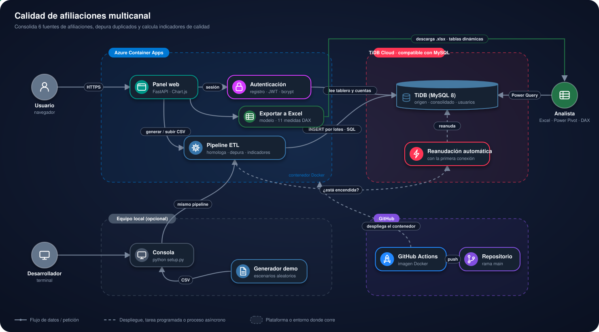

# Calidad de afiliaciones multicanal

<p>
  <a href="https://calidad-afiliaciones.blueocean-86680030.eastus.azurecontainerapps.io/"></a>
  <a href="https://frontend-nine-topaz-99.vercel.app"></a>
  <a href="https://d4i3vsgw7xwmh.cloudfront.net"></a>
</p>


> 📘 **[Manual de usuario](docs/MANUAL.md)**: cómo usar cada pantalla del panel, paso a paso y con imágenes.

## Contenido

1. [Presentación](#1-presentación)
2. [Cómo funciona](#2-cómo-funciona)
3. [Arquitectura](#3-arquitectura)
4. [Estructura del proyecto](#4-estructura-del-proyecto)
5. [Uso por consola y en Excel](#5-uso-por-consola-y-en-excel)
6. [Instalación para pruebas](#6-instalación-para-pruebas)
7. [Autor y licencia](#7-autor-y-licencia)

---

## 1. Presentación

Consolidación y análisis de calidad de la producción de afiliaciones de una EPS que recibe trámites
por tres canales distintos, más un histórico de radicación y un archivo de novedades laborales.

**El problema:** cada canal reporta con su propio formato, el mismo afiliado puede radicar por
varias vías y no existe una cifra única de producción en la que se pueda confiar.

- **Qué hace:** junta los archivos de los tres canales (digital, SAT y físico) y los históricos,
  identifica a cada afiliado con una sola llave, elimina los duplicados y entrega **una cifra única
  y confiable** de producción, con marcas de calidad para cada registro.
- **Para quién:** equipos de calidad u operación que necesitan saber cuántas afiliaciones reales
  hubo y qué problemas tienen los datos.
- **Cómo se usa:** desde el navegador ([demo en vivo](https://calidad-afiliaciones.blueocean-86680030.eastus.azurecontainerapps.io/),
  con registro libre y datos de ejemplo por cuenta), desde la terminal (`python setup.py`) o desde
  Excel con Power Query.

### Seis fuentes que no hablan entre sí

| Fuente | Registros | Qué aporta |
|---|---|---|
| Canal digital | 64.562 | Portal y aplicación, con estado del trámite |
| SAT | 10.013 | Radicación oficial ante el Ministerio |
| Canal físico | 1.332 | Puntos de atención presencial |
| Radicación histórica | 218.416 | Antecedente del afiliado y entidad previa |
| Novedades laborales | 167.274 | Relaciones laborales, no afiliaciones |
| Catálogo de documentos | 15 | Homologación de tipos de identificación |

Tres obstáculos impiden sumar directamente:

- **Los tipos de documento no coinciden.** SAT usa el código numérico del catálogo; las demás
  fuentes, la abreviatura. Un `CC` y un `3` son el mismo tipo de documento.
- **El mismo afiliado aparece varias veces**, entre canales y dentro del mismo canal.
- **Las novedades laborales parecen afiliaciones:** si se incluyen, multiplican la producción por
  más de tres.

## 2. Cómo funciona

1. **Carga.** Los archivos entran tal cual, como texto: rechazar filas impediría medir la calidad.
2. **Homologación.** Cada afiliado recibe una llave única (tipo + número de documento) común a todos
   los canales.
3. **Antecedente histórico.** Con la radicación histórica se decide si es reinscripción, traslado o
   afiliación nueva.
4. **Depuración.** Queda un registro por afiliado, según la prioridad del canal.
5. **Marcas de calidad.** Se acumulan sobre cada registro, sin reemplazar la clasificación.
6. **Indicadores.** Tablero web, consola y exportación a Excel y CSV.

Cada paso está en un archivo de `sql/`, comentado con el criterio que aplica.

## 3. Arquitectura

<p align="center">
  
</p>

- El panel web (FastAPI + Jinja2) corre el mismo proceso que la consola; cada cuenta ve solo sus
  propios datos. Los gráficos se dibujan en el navegador con Chart.js.
- **Exportar a Excel** arma un libro con modelo de datos, 11 medidas DAX y tablas dinámicas.
- La carga se hace por lotes desde Python: funciona sin cambiar la configuración del servidor y
  resuelve de paso que los archivos vienen en latin-1 y con separadores distintos.

## 4. Estructura del proyecto

```
sql/          Esquema, homologación, consolidado e indicadores
proceso/      Carga por lotes, ejecución del SQL, análisis y el proceso completo
web/          Panel web: rutas, tablero, exportación a Excel, plantillas y estilos
generador/    Datos sintéticos con un escenario distinto por generación
datos/        Archivos de entrada y salida (excluidos del repositorio)
docs/         Manual de usuario y diagramas
setup.py      Comando único para la consola
```

## 5. Uso por consola y en Excel

**Consola.** Con los archivos de origen en `datos/entrada/` (o con los sintéticos):

```bash
python generador/datos_demo.py   # opcional: crea las seis fuentes de ejemplo
python setup.py                  # esquema, carga, consolidado e indicadores
```

| Comando | Qué hace |
|---|---|
| `python setup.py` | Todo el proceso |
| `python setup.py --solo-carga` | Recarga los archivos sin recrear el esquema |
| `python setup.py --solo-analisis` | Recalcula vistas e indicadores |
| `python setup.py --exportar` | Exporta el consolidado a `datos/salida/` |

El generador acepta `--escala 3` (triple de filas) y `--semilla 7` (otra aleatoriedad
reproducible), y no sobrescribe archivos existentes sin `--forzar`.

**Excel.** Power Query se conecta a la tabla `consolidado` con el conector de MySQL para Excel y
las credenciales de tu propia base; al agregarla al modelo de datos se arman tablas dinámicas por
periodo, clasificación y canal.

> **Los archivos de origen no están en el repositorio**: contienen datos personales. Un `.xlsx`
> con datos cargados al modelo guarda una copia completa dentro del archivo; por eso el repositorio
> excluye los `.xlsx` y los CSV de datos.

## 6. Instalación para pruebas

Requisitos: Python 3.12 y una base MySQL 8 propia.

```bash
git clone https://github.com/lariasca1994/calidad-afiliaciones.git
cd calidad-afiliaciones
python -m venv .venv
.venv\Scripts\Activate.ps1        # Windows (en Linux o macOS: source .venv/bin/activate)
pip install -r requirements.txt
cp .env.example .env              # completa las variables que indica la plantilla
```

- **Panel web en local:** `uvicorn web.main:app --reload --port 8400` y abre `http://localhost:8400`.
- **Pruebas automáticas:** `python -m pytest -q tests` (no usan la base ni envían correos). El
  despliegue las corre antes de publicar: si alguna falla, no se publica.

Nunca subas tu `.env` al repositorio.

## 7. Autor y licencia

**Luis F. A.** · [GitHub](https://github.com/lariasca1994) · [LinkedIn](https://linkedin.com/in/lfac1)

Contacto: Telegram [@lfac6](https://t.me/lfac6) · WhatsApp [@carraian160](https://wa.me/carraian160) ·
[ariascluisf@hotmail.com](mailto:ariascluisf@hotmail.com)
