# 📘 Manual de usuario · Calidad de afiliaciones

## 1. Portada

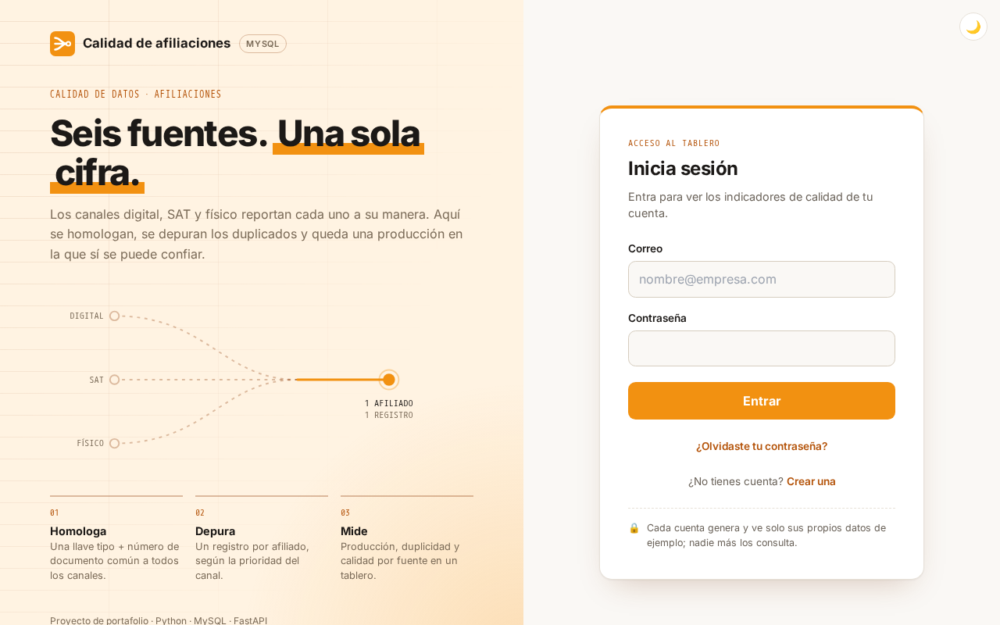

| | |
|---|---|
| **Producto** | Calidad de afiliaciones |
| **Documento** | Manual de usuario |
| **Versión** | 2.0 · noviembre de 2026 |
| **Dirigido a** | Analistas, coordinadores y equipos de calidad de datos de afiliación |
| **Dirección** | [calidad-afiliaciones](https://calidad-afiliaciones.blueocean-86680030.eastus.azurecontainerapps.io/) |
| **Autor** | Luis F. A. |

## Contenido

1. [Portada](#1-portada)
2. [Introducción](#2-introducción)
3. [Objetivo](#3-objetivo)
4. [Alcance](#4-alcance)
5. [Acceso al sistema](#5-acceso-al-sistema)
6. [Pantalla principal](#6-pantalla-principal)
7. [Navegación](#7-navegación)
8. [Funcionalidades](#8-funcionalidades)
9. [Gestión de perfil](#9-gestión-de-perfil)
10. [Mensajes frecuentes](#10-mensajes-frecuentes)
11. [Preguntas frecuentes](#11-preguntas-frecuentes)
12. [Glosario](#12-glosario)

---

## 2. Introducción

Las afiliaciones llegan por tres canales (digital, SAT y físico) y cada uno las reporta a su
manera. **Calidad de afiliaciones** recibe esos archivos, los unifica, deja **un solo registro por
afiliado** y muestra en un tablero cuántas afiliaciones reales hubo, por dónde llegaron y qué tan
confiables son los datos.

Si no tienes archivos propios, un botón genera datos de ejemplo con los mismos problemas que tienen
los reales. Este manual explica cada pantalla, paso a paso y con imágenes.

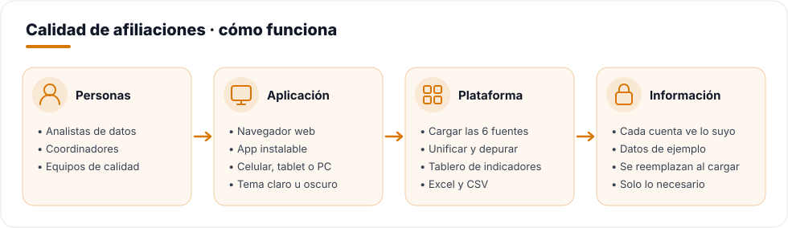

## 3. Objetivo

Que cualquier persona pueda, sin conocimientos técnicos:

- Crear su cuenta e ingresar de forma segura.
- Cargar datos (de ejemplo o propios) y obtener una cifra de producción confiable.
- Consultar los indicadores de calidad por canal, en el tiempo y por territorio.
- Descargar los resultados en Excel o CSV para su propio análisis.

## 4. Alcance

**Incluye:** registro e ingreso con verificación en dos pasos, generación de datos de ejemplo,
carga de los seis archivos de origen, tablero de indicadores con filtro por canal, descarga en Excel
con tablas dinámicas y en CSV, cambio de contraseña y métodos de verificación.

**No incluye:** corrección de los archivos de origen ni envío de reportes a terceros.

**Qué necesitas:** un navegador actualizado, conexión a internet, un correo propio y una app
autenticadora en el celular (o acceso a tu correo para recibir códigos). Para el Excel con tablas
dinámicas, Excel de escritorio para Windows 2016 o posterior.

**Buenas prácticas:** es una plataforma de demostración pública; usa los datos de ejemplo o
archivos sin documentos reales de afiliados. El Excel descargado guarda una copia de tus datos:
trátalo como un archivo con información.

## 5. Acceso al sistema

### 5.1 Crear una cuenta

En la pantalla de ingreso pulsa **Crear una**.

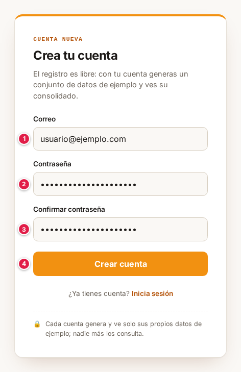

| # | Campo | Qué escribir |
|:-:|---|---|
| 1 | Correo | Un correo al que tengas acceso: lo usarás para entrar y para recuperar la cuenta |
| 2 | Contraseña | Una contraseña larga que no uses en otros sitios |
| 3 | Confirmar contraseña | La misma contraseña |
| 4 | Crear cuenta | Crea tu cuenta y te lleva a configurar la verificación en dos pasos |

### 5.2 Iniciar sesión

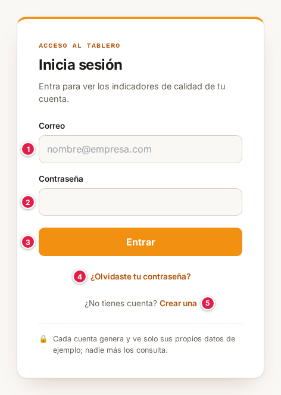

| # | Elemento | Qué hace |
|:-:|---|---|
| 1 | Correo | El correo de tu cuenta |
| 2 | Contraseña | Tu contraseña |
| 3 | Entrar | Comprueba tus datos y pasa a la verificación en dos pasos |
| 4 | ¿Olvidaste tu contraseña? | Abre la recuperación de contraseña (5.4) |
| 5 | Crear una | Abre el registro (5.1) |

### 5.3 Verificación en dos pasos

Cada ingreso pide, además de la contraseña, un código de 6 dígitos. La primera vez eliges cómo
recibirlo: con una **app autenticadora** (escaneas un código QR y la app muestra un código nuevo
cada 30 segundos, incluso sin internet) o con un **código por correo**.

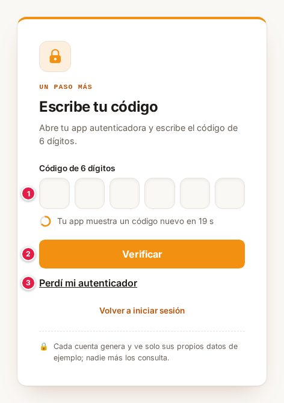

| # | Elemento | Qué hace |
|:-:|---|---|
| 1 | Código de 6 dígitos | Una casilla por dígito: puedes teclearlo o pegarlo completo. El anillo indica cuánto falta para que la app muestre otro código |
| 2 | Verificar | Confirma el código y abre el tablero |
| 3 | Perdí mi autenticador | Si ya no tienes la app, te envía un código al correo de tu cuenta para configurar una app nueva |

**Perdí mi autenticador:** pulsa el enlace, escribe el código que llega a tu correo y escanea el
nuevo código QR con tu app. La app anterior deja de servir en ese momento.

### 5.4 Recuperar la contraseña

| # | Elemento | Qué hace |
|:-:|---|---|
| 1 | Correo | El correo de tu cuenta |
| 2 | Enviar enlace | Envía a ese correo un enlace para crear una contraseña nueva |

El mensaje es el mismo exista o no la cuenta. Abre el enlace del correo (vence en poco tiempo y
sirve una sola vez), escribe la contraseña nueva (mínimo 8 caracteres) y vuelve a ingresar. Tu
verificación en dos pasos sigue igual.

## 6. Pantalla principal

Al ingresar se abre el **Tablero de indicadores**.

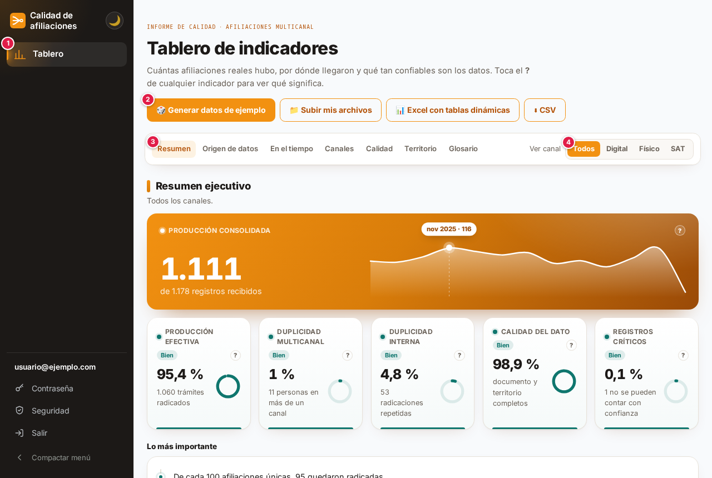

| # | Elemento | Qué hace |
|:-:|---|---|
| 1 | Menú lateral | Lleva al tablero y, al pie, a Contraseña, Seguridad y Salir (ver 7. Navegación) |
| 2 | Acciones | Generar datos de ejemplo, subir tus archivos y descargar en Excel o CSV |
| 3 | Secciones | Saltan a cada parte del tablero: Resumen, Origen de datos, En el tiempo, Canales, Calidad, Territorio y Glosario |
| 4 | Ver canal | Filtra todo el tablero por Todos, Digital, Físico o SAT |

Debajo aparece el **Resumen ejecutivo**: la tarjeta principal con la producción consolidada y su
curva por mes, y cinco indicadores con semáforo (verde, ámbar o rojo). El botón **?** de cada
indicador explica qué mide y cuál es su referencia.

## 7. Navegación

En el computador el menú está a la izquierda. **Compactar menú** lo reduce a íconos (al pasar el
cursor aparece el nombre de cada opción) y la preferencia se recuerda en ese equipo.

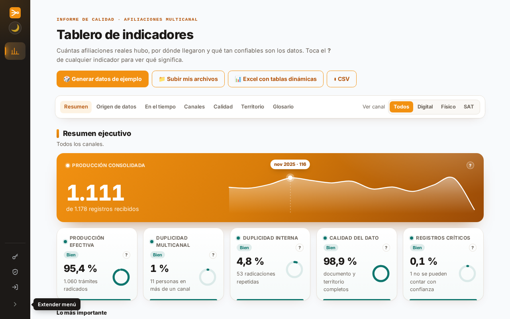

En la tablet en vertical y en el celular, el menú pasa a una **barra inferior** con Tablero,
Seguridad y **Más**, que abre una hoja con Contraseña y Salir. El tablero se reacomoda al girar la
pantalla.

| Tablet en vertical | Celular con la hoja "Más" |
|:-:|:-:|
| 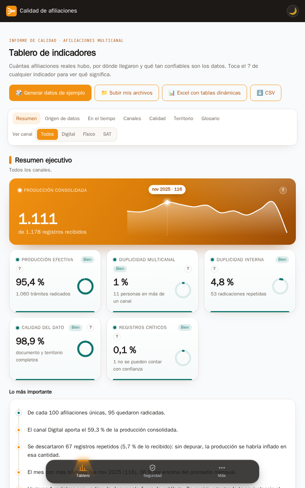 | 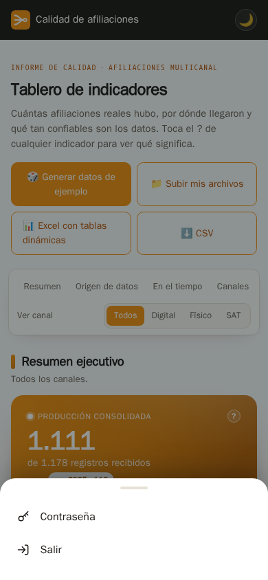 |

| Opción | Lleva a |
|---|---|
| Tablero | La pantalla principal |
| Contraseña | El cambio de contraseña (9.1) |
| Seguridad | Tus métodos de verificación (9.2) |
| Salir | Cierra la sesión |
| 🌙 / ☀️ | Alterna entre tema claro y oscuro |

## 8. Funcionalidades

### 8.1 Crear: cargar datos

Tienes dos formas de cargar datos. Cualquiera de las dos **reemplaza** lo que tenía tu cuenta y
recalcula el tablero en unos segundos.

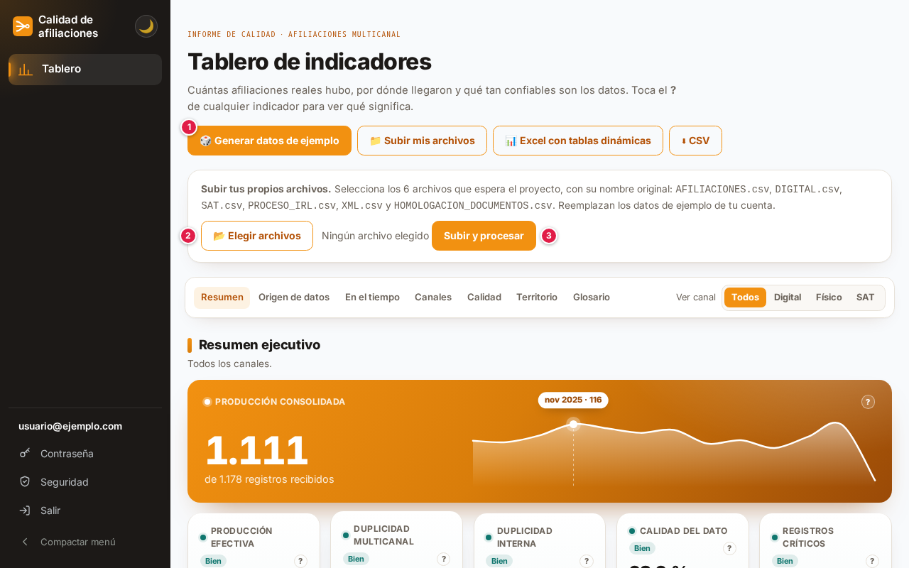

| # | Elemento | Qué hace |
|:-:|---|---|
| 1 | 🎲 Generar datos de ejemplo | Crea un conjunto nuevo solo para tu cuenta. Cada clic simula un periodo distinto |
| 2 | 📂 Elegir archivos | Abre la selección de tus archivos; al lado se indica cuántos elegiste |
| 3 | Subir y procesar | Carga los archivos y corre la depuración |

**Archivos propios:** se suben los **6 archivos a la vez**, con su nombre exacto:
`AFILIACIONES.csv`, `DIGITAL.csv`, `SAT.csv`, `PROCESO_IRL.csv`, `XML.csv` y
`HOMOLOGACION_DOCUMENTOS.csv`. No se acepta una carga parcial.

**Datos de ejemplo:** cada generación sortea un escenario, que el recuadro 🧪 del tablero muestra:

| Escenario | Qué cambia |
|---|---|
| Operación estable | Los tres canales en su proporción habitual |
| Campaña de afiliación | Mucho más volumen digital, un mes pico y más duplicados |
| Canal presencial fuerte | El canal físico y SAT pesan más que el portal |
| Cierre con rechazos | Muchos trámites anulados, rechazados o sin prerradicar |
| Migración de sistema | Documentos fuera de catálogo y territorios sin dato |

### 8.2 Consultar: leer el tablero

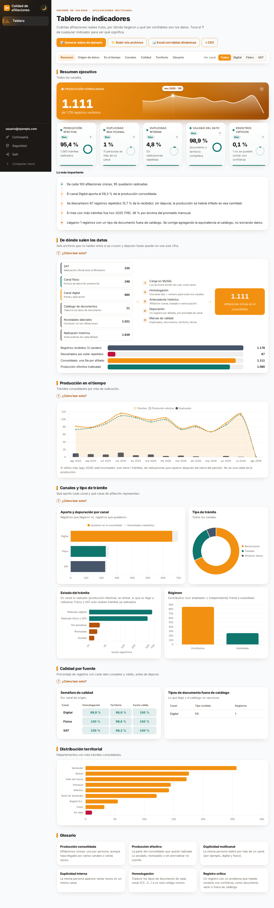

| Sección | Qué responde |
|---|---|
| Resumen ejecutivo | La producción consolidada y los cinco indicadores: producción efectiva, duplicidad multicanal, duplicidad interna, calidad del dato y registros críticos |
| Lo más importante | Los hallazgos en frases sencillas: qué canal pesa más, cuánto se descartó, el mes pico |
| De dónde salen los datos | Los seis archivos con sus filas, los pasos del proceso y el embudo: recibidos → descartados por repetidos → consolidado → producción efectiva |
| Producción en el tiempo | Trámites, producción efectiva y duplicados por mes; avisa si el último mes está incompleto |
| Canales y tipo de trámite | Aporte por canal, tipo de trámite, estado y régimen |
| Calidad por fuente | Semáforo de homologación, territorio y fecha válida por canal, y documentos fuera de catálogo |
| Distribución territorial | Departamentos con más trámites; "Sin dato" en rojo cuando falta el territorio |
| Glosario | Qué significa cada término |

Cada sección tiene un **¿Cómo leer esto?** con la explicación. En los gráficos, pasa el cursor (o
toca) para ver el valor exacto, o toca la leyenda para ocultar una serie.

### 8.3 Modificar: cambiar la vista y los datos

**Filtrar por canal.** En **Ver canal** elige Digital, Físico o SAT: todo el tablero (indicadores,
hallazgos, embudo, gráficos y territorio) se recalcula sin recargar la página. **Todos** vuelve a
la vista completa.

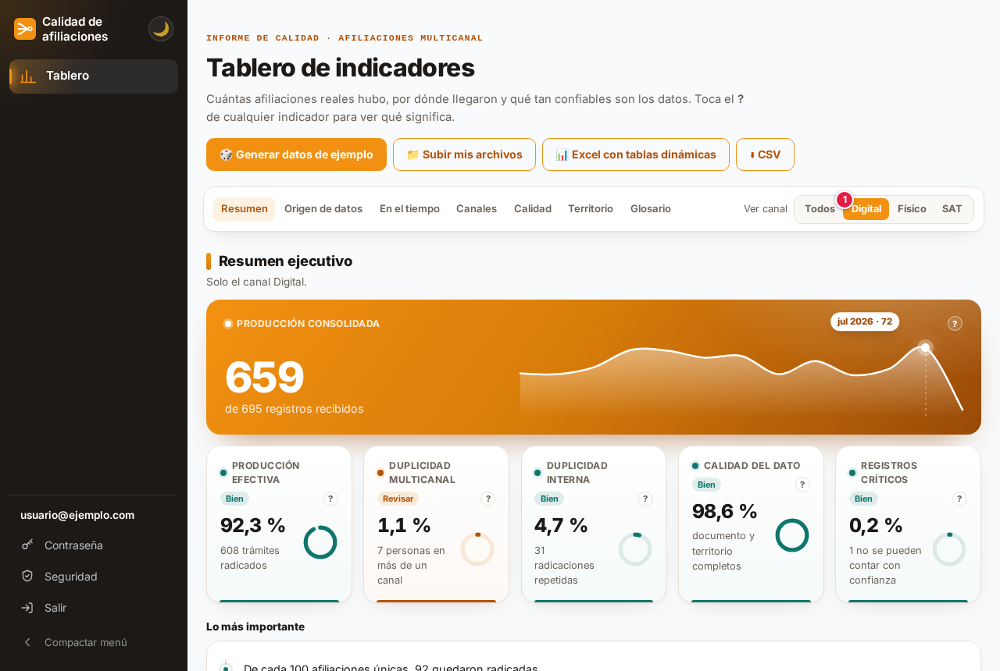

| # | Elemento | Qué hace |
|:-:|---|---|
| 1 | Canal elegido | El botón activo indica el canal que estás viendo; el subtítulo del resumen lo confirma |

**Reemplazar los datos.** Para cambiar los datos de tu cuenta, vuelve a cargar con 8.1: la carga
nueva reemplaza por completo a la anterior.

### 8.4 Reportar: descargar Excel o CSV

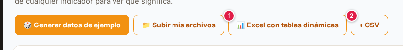

| # | Botón | Qué descarga |
|:-:|---|---|
| 1 | 📊 Excel con tablas dinámicas | `calidad_afiliaciones.xlsx` con tres hojas: **Inicio** (cómo usar el libro), **Tablero** (tablas dinámicas por canal, periodo, tipo de trámite y departamento, con segmentaciones de Canal y Régimen) y **Datos** (tu consolidado, una fila por afiliado) |
| 2 | ⬇️ CSV | `consolidado.csv`: un archivo plano con el consolidado, sin tablas dinámicas |

Al abrir el Excel, si aparece **Vista protegida**, pulsa **Habilitar edición**; si las tablas
dinámicas muestran otras cifras, usa **Datos → Actualizar todo**.

## 9. Gestión de perfil

### 9.1 Cambiar contraseña

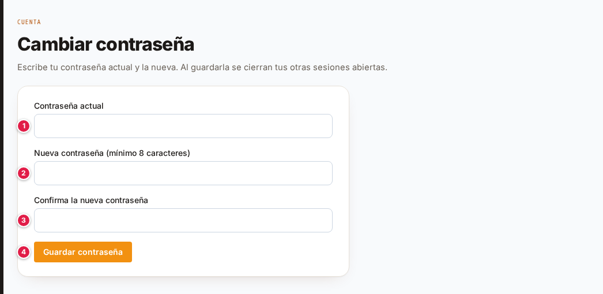

| # | Campo | Qué escribir |
|:-:|---|---|
| 1 | Contraseña actual | Tu contraseña de hoy |
| 2 | Nueva contraseña | Mínimo 8 caracteres, distinta de la actual |
| 3 | Confirma la nueva contraseña | La misma contraseña nueva |
| 4 | Guardar contraseña | Guarda el cambio; tu sesión sigue abierta y se cierran las de otros equipos |

### 9.2 Seguridad

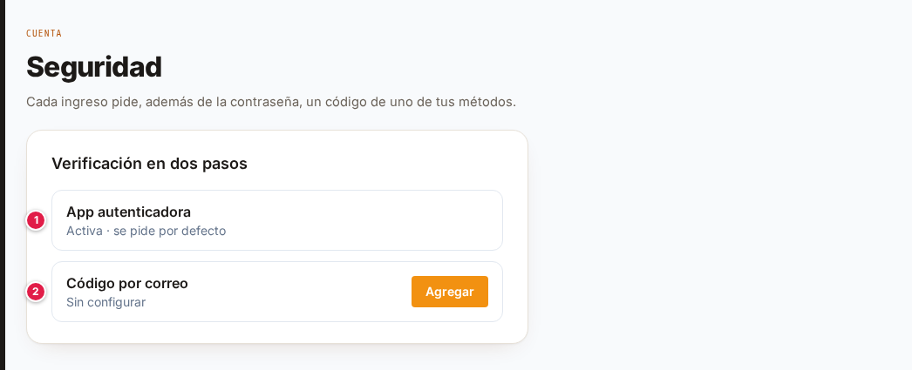

| # | Método | Qué puedes hacer |
|:-:|---|---|
| 1 | App autenticadora | Ver si está activa y si es el método que se pide por defecto |
| 2 | Código por correo | **Agregar** el método que te falta o **Pedir este por defecto** |

Tener los dos métodos activos te permite entrar aunque no tengas el celular a mano.

## 10. Mensajes frecuentes

| Mensaje | Qué significa | Qué hacer |
|---|---|---|
| Correo o contraseña incorrectos | Los datos no coinciden | Revísalos o usa **¿Olvidaste tu contraseña?** |
| El código no es correcto o ya venció. | El código escrito no es el vigente | Escribe el código que muestra ahora la app |
| Las contraseñas no coinciden | La contraseña y su confirmación son distintas | Escríbelas de nuevo |
| En mantenimiento | El servicio está encendiéndose o no responde | Espera: la pantalla reintenta sola y vuelve al tablero cuando el servicio responde |
| Sin conexión | Tu equipo no tiene internet | La pantalla reintenta sola, o pulsa **Reintentar ahora** |
| Esta afiliación no está en el reporte | La dirección que abriste no existe | Usa **Ver el tablero** o **Volver al inicio** |

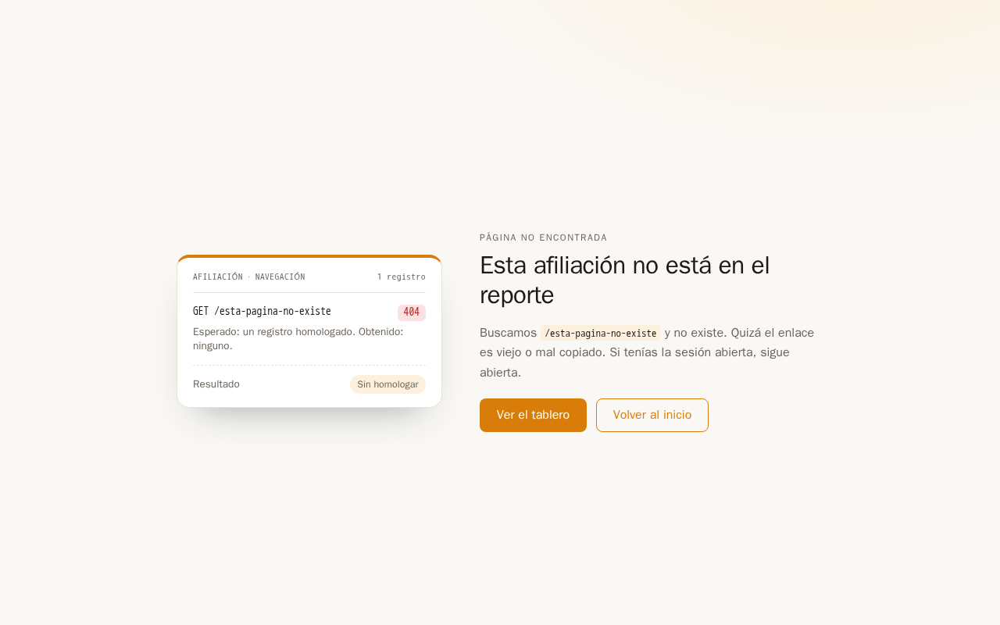

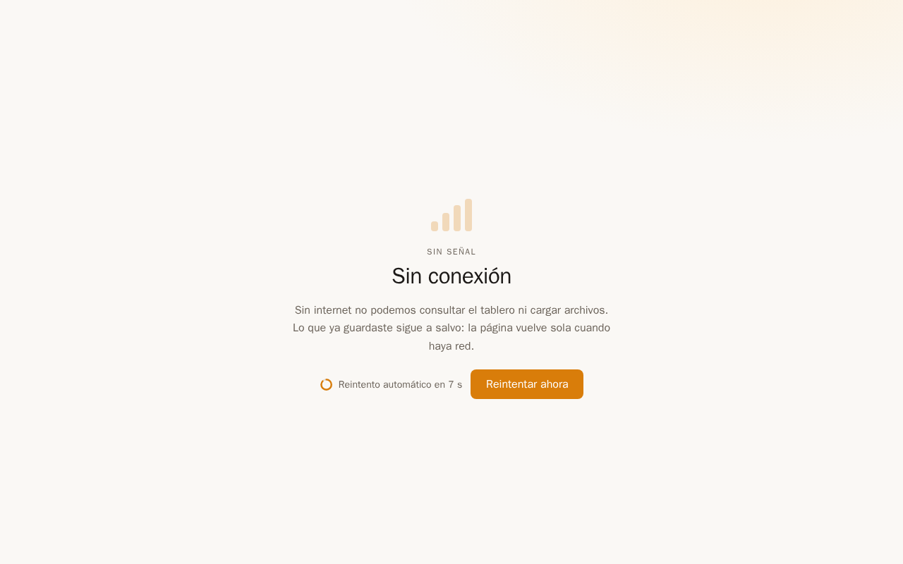

## 11. Preguntas frecuentes

**¿Por qué a veces aparece "En mantenimiento" al entrar?** El servicio se suspende cuando nadie lo
usa y tarda unos minutos en reactivarse. La pantalla reintenta sola.

**¿Otra persona puede ver mis datos?** No. Cada cuenta ve solo lo que generó o subió.

**¿Cómo borro mis datos?** Al generar datos de ejemplo o subir archivos nuevos se reemplaza todo
lo que tenía tu cuenta.

**¿Por qué cada generación da cifras distintas?** A propósito: cada una simula un periodo diferente
(ver el recuadro 🧪), para ver cómo cambia el informe cuando cambian el volumen, la duplicidad o la
calidad.

**El Excel abre con las tablas dinámicas vacías.** Pulsa **Habilitar edición** y luego
**Datos → Actualizar todo**. Excel en la web y Excel para Mac no editan este tipo de libros.

**¿Se puede instalar como aplicación?** Sí: en Chrome o Edge, **Instalar aplicación**; en iPhone,
Safari → **Compartir → Agregar a inicio**.

**¿Dónde pido ayuda o reporto un problema?** Telegram [@lfac6](https://t.me/lfac6), WhatsApp
[@carraian160](https://wa.me/carraian160) o [ariascluisf@hotmail.com](mailto:ariascluisf@hotmail.com).

## 12. Glosario

| Término | Qué significa |
|---|---|
| **Afiliación única** | Una persona contada una sola vez, aunque haya llegado por varios canales |
| **App autenticadora** | Aplicación del celular que muestra un código nuevo cada 30 segundos para confirmar que eres tú |
| **Canal** | Vía por la que llegó la afiliación: digital, SAT o físico |
| **Consolidado** | La lista final, con una fila por afiliado, después de depurar |
| **CSV** | Archivo de texto con datos en columnas que se abre en Excel o Google Sheets |
| **Duplicidad multicanal** | La misma persona radicó por más de un canal |
| **Duplicidad interna** | La misma persona aparece varias veces en un mismo canal |
| **Homologación** | Traducir los tipos de documento de cada canal a un solo código común |
| **Producción efectiva** | La parte del consolidado que quedó radicada |
| **Registro crítico** | Un registro con un problema que impide contarlo con confianza |
| **Tabla dinámica** | Resumen de Excel que agrupa y suma los datos y se puede reorganizar |
| **Verificación en dos pasos** | Además de la contraseña, se pide un código que solo tú puedes recibir |
