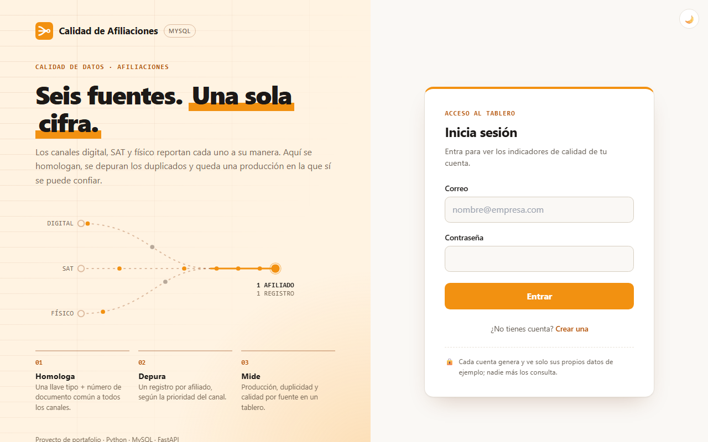
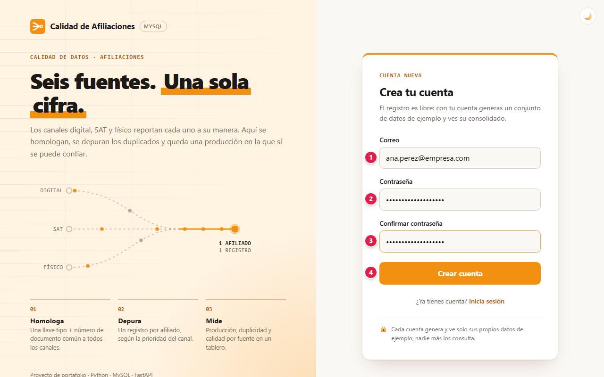
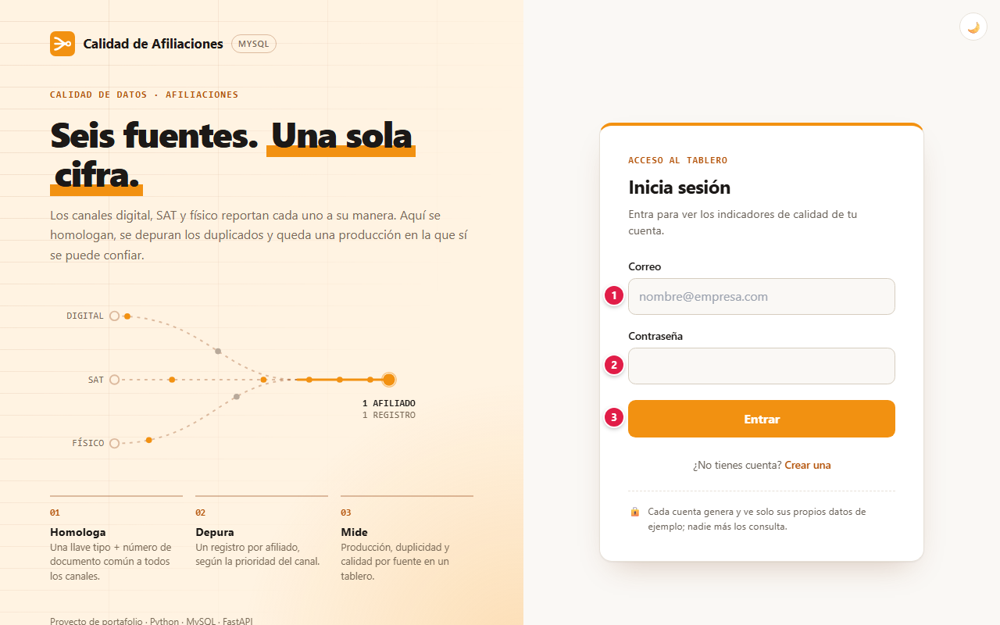
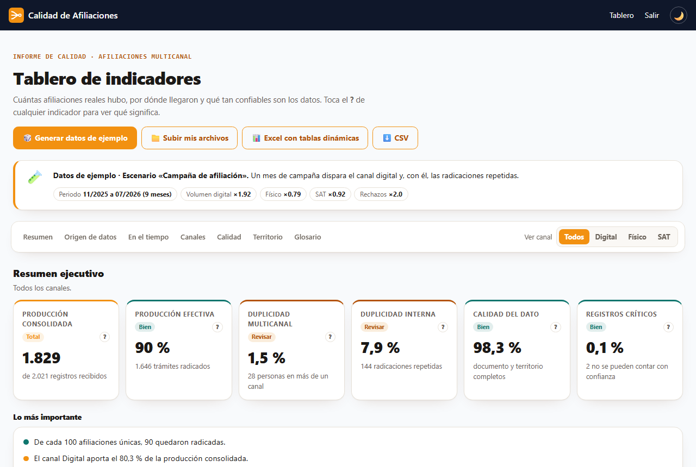
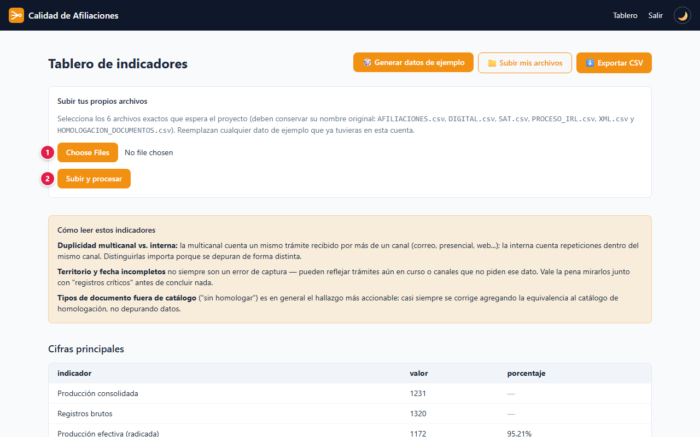
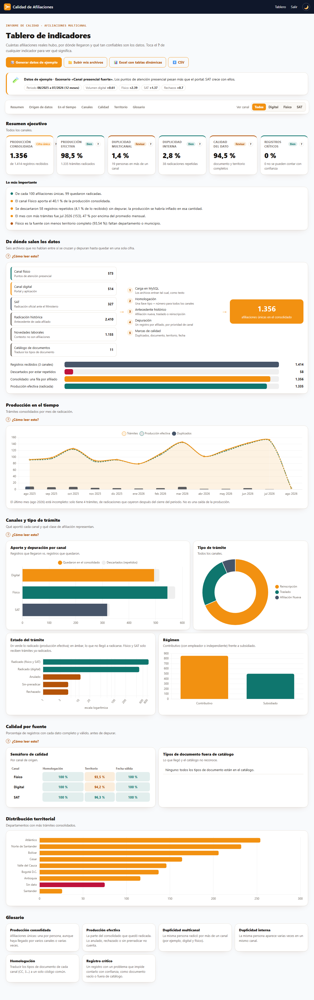

# 📘 Manual de usuario · Calidad de afiliaciones

Guía para usar el panel web paso a paso: qué significa cada campo, qué datos se ingresan y qué
protege la plataforma. Para la parte técnica (arquitectura, consola, Power Query) vuelve al
[README](../README.md).

**Demo:** [calidad-afiliaciones (Azure Container Apps)](https://calidad-afiliaciones.blueocean-86680030.eastus.azurecontainerapps.io/)

## Contenido

1. [Proyecto: objetivos y alcances](#1-proyecto-objetivos-y-alcances)
2. [Glosario](#2-glosario)
3. [Plataformas, base de datos y servicios](#3-plataformas-base-de-datos-y-servicios)
4. [Paso a paso](#4-paso-a-paso)
5. [Seguridad: tu información protegida](#5-seguridad-tu-información-protegida)
6. [Agradecimientos](#6-agradecimientos)

---

## 1. Proyecto: objetivos y alcances

### Objetivo

El panel recibe los archivos de afiliación de tres canales (digital, SAT y físico) más los
históricos, deja **un solo registro por afiliado** y muestra una cifra de producción confiable con
sus problemas de calidad. Si no tienes archivos propios, un botón genera datos sintéticos con los
mismos problemas que tienen los reales.

### Alcance: qué necesitas y qué esperar

- Solo necesitas un navegador; no hay que instalar nada.
- La base de datos se apaga cuando nadie la usa. Si al entrar aparece la página **En
  mantenimiento**, la base se está encendiendo: espera unos minutos y vuelve a intentarlo.
- **Usa datos de ejemplo.** La demo es pública; no subas archivos con documentos reales de
  afiliados (ver [Límites](#1-proyecto-objetivos-y-alcances)).

### Límites

Es una demo de portafolio, no un sistema certificado para datos personales de salud:

- **No subas datos reales de afiliados** a la instancia pública. Para datos reales, corre el
  proyecto en tu equipo (ver [Instalación](../README.md#6-instalación-para-pruebas)).
- El registro no verifica el correo: para recuperar la cuenta con **¿Olvidaste tu contraseña?**,
  regístrate con un correo al que tengas acceso.
- El registro no exige longitud mínima de contraseña (al cambiarla o restablecerla sí: 8
  caracteres): elige una contraseña larga y que no uses en otros sitios.
- El Excel que descargas del tablero (y cualquier libro conectado a la base) guarda una copia de
  los datos dentro del `.xlsx`, también en su modelo de datos. Trátalo como un archivo con datos.

## 2. Glosario

Palabras técnicas que aparecen en este manual, explicadas en lenguaje simple.

| Término | Qué significa |
|---|---|
| **Administrador** | Cuenta con permisos para gestionar usuarios y configuraciones de la aplicación. |
| **API** | Puerta de entrada de un programa para que otros programas le pidan o le envíen datos. |
| **Arranque en frío** | Los servidores gratuitos se apagan sin uso; la primera visita tarda unos segundos mientras vuelven a encenderse. |
| **Base de datos** | Lugar donde la aplicación guarda la información de forma ordenada y permanente. |
| **Cifrado / TLS / HTTPS** | Protección que codifica la información mientras viaja, para que nadie en el camino pueda leerla. |
| **Contraseña cifrada (hash)** | La contraseña no se guarda tal cual, sino como una "huella" de la que no se puede recuperar el texto original. |
| **Cookie** | Pequeño dato que el navegador guarda para recordar tu sesión en ese sitio. |
| **CSV** | Archivo de texto con datos en columnas, que se abre en Excel o Google Sheets. |
| **Excel / XLSX** | Formato de hoja de cálculo de Microsoft Excel. |
| **JWT** | Tipo de token firmado digitalmente: si alguien lo altera, el servidor lo rechaza. |
| **Modo mantenimiento** | Pantalla que aparece cuando el servicio o su base de datos no responden; se recupera sola cuando vuelven. |
| **Navegador** | Programa con el que abres páginas web: Chrome, Edge, Firefox, Safari. |
| **Nube** | Servidores de una empresa (Amazon, Microsoft, Google, Oracle…) donde la aplicación funciona sin depender de un computador propio. |
| **Rate limit (límite de intentos)** | Tope de intentos en poco tiempo, para frenar a quien intenta adivinar contraseñas. |
| **Servidor** | Computador en la nube que atiende las peticiones de la aplicación. |
| **Sesión** | El tiempo en que la aplicación te reconoce después de iniciar sesión, sin pedirte la contraseña de nuevo. |
| **Tema claro / oscuro** | Combinación de colores de la interfaz; puedes elegir la clara o la oscura. |
| **Variables de entorno / secretos** | Claves y contraseñas internas de la aplicación, guardadas fuera del código para que no queden expuestas. |

## 3. Plataformas, base de datos y servicios

Qué servicio de nube, base de datos o API usa el proyecto y para qué sirve cada uno.

| Plataforma | Tipo | Qué hace en el proyecto |
|---|---|---|
|  | Nube | Corre el panel web (FastAPI + Jinja2) y el mismo pipeline ETL que usa la consola. |
|  | Base de datos | Aiven aloja la base MySQL 8 con las seis fuentes, el consolidado y las cuentas del panel. Si está dormida, el proyecto la despierta con la API de Aiven antes de conectarse. |
|  | Formato de archivo | Se conecta directo a la tabla `consolidado` para armar tablas dinámicas. |
|  | Automatización | Construye la imagen Docker y la despliega en Azure. |
|  | Pruebas automatizadas | Prueba la demo automáticamente y publica la evidencia. |

## 4. Paso a paso

### 4.1 Portada

Desde la portada eliges **Crear cuenta** o **Iniciar sesión**. El botón de la luna, arriba a la
derecha, cambia entre tema claro y oscuro.

### 4.2 Crear una cuenta

| # | Campo | Qué escribir | Reglas |
|:-:|---|---|---|
| 1 | Correo | El correo con el que vas a entrar | Formato de correo válido; se guarda en minúsculas. Solo se le escribe si pides recuperar la contraseña |
| 2 | Contraseña | Tu contraseña | Máximo 72 bytes (las tildes, la ñ y los emojis cuentan doble o más) |
| 3 | Confirmar contraseña | La misma contraseña | Debe coincidir con el campo 2 |
| 4 | Crear cuenta | Botón | Crea la cuenta vacía y te lleva a elegir tu verificación en dos pasos |

El registro es libre y no requiere aprobación. Si el correo ya existe, el panel lo avisa.

### 4.3 Iniciar sesión

| # | Campo | Qué escribir |
|:-:|---|---|
| 1 | Correo | El correo de tu cuenta |
| 2 | Contraseña | Tu contraseña |
| 3 | Entrar | Pide el código de tu verificación en dos pasos; al escribirlo y pulsar **Verificar** se abre tu tablero |

Si el correo o la contraseña no coinciden, el mensaje es el mismo en ambos casos, para no revelar
qué correos están registrados.

### 4.3.1 Olvidé mi contraseña

1. En el inicio de sesión pulsa **¿Olvidaste tu contraseña?** y escribe el correo de tu cuenta.
2. El panel responde siempre lo mismo, exista o no la cuenta, para no revelar qué correos están
   registrados. Si existe, llega un correo con el enlace **Crear contraseña nueva**.
3. El enlace vence en 30 minutos y sirve una sola vez. Escribe la nueva contraseña (mínimo 8
   caracteres) y su confirmación, y vuelve a iniciar sesión.

Se pueden pedir como máximo 3 enlaces cada 15 minutos por correo; pedirlos no bloquea el ingreso.

### 4.3.2 Cambiar la contraseña

Con la sesión iniciada, pulsa **Contraseña** en la barra superior. Escribe la contraseña actual,
la nueva (mínimo 8 caracteres y distinta de la actual) y su confirmación.

### 4.3.3 Verificación en dos pasos (obligatoria)

Cada ingreso pide, además de la contraseña, un código. La primera vez que ingresas (o al crear la
cuenta) eliges cómo recibirlo:

| Método | Cómo funciona |
|---|---|
| **App autenticadora** (recomendado) | Escaneas un código QR con Google Authenticator, Microsoft Authenticator u otra app; desde ese momento la app muestra un código nuevo cada 30 segundos, incluso sin internet. Si no puedes escanear, escribe la clave que aparece bajo el QR. |
| **Código por correo** | Cada vez que ingresas te llega un código de 6 dígitos que vence en 10 minutos y sirve una sola vez. |

Confirma el método escribiendo el primer código. Desde **Seguridad** (barra superior) puedes
**agregar el método que no elegiste** y escoger cuál se pide **por defecto**; tener los dos te
permite entrar aunque no tengas el teléfono a mano.

### 4.4 Tablero de indicadores

| # | Botón | Qué hace |
|:-:|---|---|
| 1 | 🎲 Generar datos de ejemplo | Crea un conjunto sintético nuevo **solo para tu cuenta** y recalcula los indicadores en unos segundos. Cada clic simula un periodo distinto (ver abajo) |
| 2 | 📁 Subir mis archivos | Abre el formulario para cargar tus propios archivos (ver 3.5) |
| 3 | 📊 Excel con tablas dinámicas | Descarga un libro con tu consolidado, medidas DAX y tablas dinámicas listas (ver 3.7) |
| 4 | ⬇️ CSV | Descarga `consolidado.csv`, un archivo plano sin medidas ni tablas dinámicas |

**Cada generación es distinta.** Además de cambiar las personas, cada clic sortea un *escenario*:
cuánto aporta cada canal, el periodo (de 8 a 18 meses), la duplicidad, los rechazos y la calidad de
los datos. El recuadro 🧪 arriba del tablero dice cuál salió, por ejemplo *«Campaña de afiliación»*
(el canal digital se dispara y con él las radicaciones repetidas) o *«Migración de sistema»*
(llegan documentos fuera de catálogo y territorios sin dato).

| Escenario | Qué cambia |
|---|---|
| Operación estable | Los tres canales en su proporción habitual |
| Campaña de afiliación | Mucho más volumen digital, un mes pico y más duplicados |
| Canal presencial fuerte | El canal físico y SAT pesan más que el portal |
| Cierre con rechazos | Muchos trámites anulados, rechazados o sin prerradicar |
| Migración de sistema | Documentos fuera de catálogo y territorios sin dato |

### 4.5 Subir tus propios archivos

| # | Campo | Qué escribir | Reglas |
|:-:|---|---|---|
| 1 | Seleccionar archivos | Los **6 archivos** de origen a la vez | Nombres exactos: `AFILIACIONES.csv`, `DIGITAL.csv`, `SAT.csv`, `PROCESO_IRL.csv`, `XML.csv` y `HOMOLOGACION_DOCUMENTOS.csv`. Máximo **50 MB** por archivo. No se acepta una carga parcial |
| 2 | Subir y procesar | Botón | Reemplaza los datos que tuviera tu cuenta y corre el mismo proceso de depuración |

### 4.6 Leer los resultados

Arriba hay una barra fija con las secciones del tablero y el filtro **Ver canal** (Todos, Digital,
Físico o SAT): al elegir un canal se recalculan los indicadores, los hallazgos, el embudo, la
tendencia, el tipo de trámite, el estado, el régimen y el territorio, sin recargar la página.

| Sección | Qué responde |
|---|---|
| Resumen ejecutivo | Seis indicadores con semáforo (verde, ámbar o rojo): producción consolidada, producción efectiva, duplicidad multicanal e interna, calidad del dato y registros críticos. El botón **?** de cada uno explica qué mide y cuál es la referencia |
| Lo más importante | Hallazgos escritos en frases sencillas: qué canal pesa más, cuánto se descartó, el mes pico, la fuente con más problemas |
| De dónde salen los datos | Los seis archivos de origen con sus filas, los pasos del proceso y el embudo: recibidos → descartados por repetidos → consolidado → producción efectiva |
| Producción en el tiempo | Trámites, producción efectiva y duplicados por mes. Si el último mes está incompleto, el tablero lo avisa |
| Canales y tipo de trámite | Aporte y depuración por canal, reinscripción/traslado/afiliación nueva, estado del trámite y régimen |
| Calidad por fuente | Semáforo de homologación, territorio y fecha válida por canal, y los tipos de documento fuera de catálogo |
| Distribución territorial | Los departamentos con más trámites; "Sin dato" en rojo cuando falta el territorio |
| Glosario | Qué significa cada término, en palabras sencillas |

Cada sección tiene un **¿Cómo leer esto?** que se despliega con la explicación, y en los gráficos
puedes pasar el cursor (o tocar) para ver el valor exacto, o tocar la leyenda para ocultar una serie.

### 4.7 Descargar el Excel con tablas dinámicas

El botón **📊 Excel con tablas dinámicas** descarga `calidad_afiliaciones.xlsx`, con tres hojas:

| Hoja | Qué tiene |
|---|---|
| Inicio | Cómo usar el libro y la fórmula DAX de cada medida |
| Tablero | Cuatro tablas dinámicas sobre el modelo de datos (resumen por canal, trámites por periodo y canal, tipo de trámite, departamento) con segmentaciones de **Canal** y **Régimen** |
| Datos | Tu consolidado, una fila por afiliado, como tabla de Excel |

La tabla entra al **modelo de datos** (Power Pivot) con 11 medidas DAX, por ejemplo
`% Efectiva = DIVIDE([Producción efectiva], [Trámites])`. Al abrir el libro, Excel recarga el modelo
y las tablas dinámicas con tus datos. Si llega en **Vista protegida**, pulsa **Habilitar edición**;
si las tablas dinámicas siguen mostrando otras cifras, usa **Datos → Actualizar todo**. Para tus
propios análisis: **Insertar → Tabla dinámica → Desde el modelo de datos** y arrastra las medidas.

### 4.8 Preguntas frecuentes

**¿Por qué a veces aparece "En mantenimiento"?** La base se apaga sin uso para no generar costos
y tarda unos minutos en volver a encenderse. Espera un momento y vuelve a entrar.

**¿Otra persona puede ver mis datos?** No. Cada cuenta ve solo lo que generó o subió.

**¿Puedo borrar mis datos?** Al generar datos de ejemplo o subir archivos nuevos, se reemplaza
todo lo que tenía tu cuenta.

**¿Por qué cada vez que genero datos salen cifras distintas?** A propósito: cada generación simula
un periodo diferente (ver el recuadro 🧪 del tablero), para que puedas ver cómo cambia el informe
cuando cambian el volumen, la duplicidad o la calidad de los datos.

**El Excel abre con las tablas dinámicas vacías o con otras cifras.** Pulsa **Habilitar edición**
si aparece la Vista protegida y, si hace falta, **Datos → Actualizar todo**. El libro necesita Excel
de escritorio para Windows 2016 o posterior (Microsoft 365 incluido): Excel en la web y Excel para
Mac no editan modelos de datos de Power Pivot.

## 5. Seguridad: tu información protegida

Tu confianza es lo primero: la plataforma solo pide los datos necesarios para funcionar, los protege y no los comparte con terceros. Esto es lo que se guarda y cómo se protege.

### Qué datos se guardan y dónde

| Dato | Para qué se usa | Dónde se guarda | Cómo se protege |
|---|---|---|---|
| Correo | Identificar tu cuenta | Tabla `usuarios` en MySQL (Aiven) | Solo lo ves tú; no se muestra a otras cuentas |
| Contraseña | Iniciar sesión | Tabla `usuarios`, **solo su huella bcrypt** | Nunca se guarda en texto plano ni se puede recuperar |
| Archivos CSV que subes | Calcular tus indicadores | Carpeta de tu cuenta en el contenedor y tablas de MySQL marcadas con tu `usuario_id` | Cada consulta filtra por tu cuenta |
| Datos de ejemplo | Probar el panel | Igual que los archivos, marcados con tu `usuario_id` | Son sintéticos: no corresponden a personas reales |
| Verificación en dos pasos | Confirmar que eres tú al ingresar | Tabla `usuarios`, columna `mfa`: clave de la app **cifrada** (AES-GCM) y código del correo **solo como huella** | Nadie: no se puede leer desde la base |
| Sesión | Mantenerte conectado | Cookie `sesion` en tu navegador | Firmada (JWT HS256), invisible para JavaScript (`HttpOnly`), vence a las 8 horas |

### Cómo se protege tu información

Comprobado en el código del proyecto (`web/seguridad.py`, `web/main.py`, `proceso/conexion.py`):

- **Verificación en dos pasos obligatoria** con app autenticadora (TOTP) o código por correo:
  la clave de la app se guarda cifrada, un código no se acepta dos veces, 5 códigos errados de la
  app la bloquean 15 minutos, y el código del correo vence en 10 minutos, admite 5 intentos y se
  pueden pedir 3 cada 10 minutos.
- **Contraseñas con bcrypt.** Solo se guarda la huella; ni el administrador puede ver tu
  contraseña.
- **Sesión en cookie `HttpOnly` y `SameSite=Lax`**, firmada con una clave secreta del servidor y
  válida por 8 horas. **Salir** la borra.
- **Aislamiento por cuenta.** Todas las tablas llevan `usuario_id` y cada consulta, carga o
  exportación se limita a tu cuenta: dos cuentas nunca ven ni mezclan sus datos, aunque generen
  datos al mismo tiempo.
- **Consultas parametrizadas** contra MySQL (sin concatenar texto del usuario en el SQL), lo que
  evita la inyección SQL.
- **Plantillas con escape automático** (Jinja2): lo que escribes se muestra como texto, no como
  código.
- **Conexión cifrada a la base.** La conexión a MySQL usa TLS por defecto, y Aiven rechaza
  conexiones sin cifrar.
- **Carga controlada.** Solo se aceptan los 6 nombres de archivo esperados, con un máximo de 50 MB
  cada uno.
- **Secretos fuera del repositorio.** La clave JWT y los datos de conexión viven en variables de
  entorno; el `.gitignore` bloquea cualquier CSV o `.xlsx` para que nunca se publiquen datos de
  afiliados. La única excepción es la plantilla del Excel descargable, que solo trae 3 filas
  inventadas: tus datos se escriben en el libro en memoria al descargarlo, nunca en el repositorio.
- **Runtime con parches de seguridad:** la imagen fija Python 3.12.15 y certifi 2026.10.19 o
  posterior, que deja de confiar en los certificados intermedios comprometidos de eMudhra. La
  imagen tampoco confía en las raíces emSign ni «AAA Certificate Services» que firmaron esos
  intermedios comprometidos de eMudhra (la misma mitigación que publicó Red Hat).

## 6. Agradecimientos

A mi familia, por su apoyo incondicional, su paciencia y por creer en cada proyecto incluso cuando apenas era una idea. Este trabajo también es de ustedes.

Y a ti, que usas esta plataforma: cada prueba, comentario y sugerencia ayuda a que siga mejorando.
